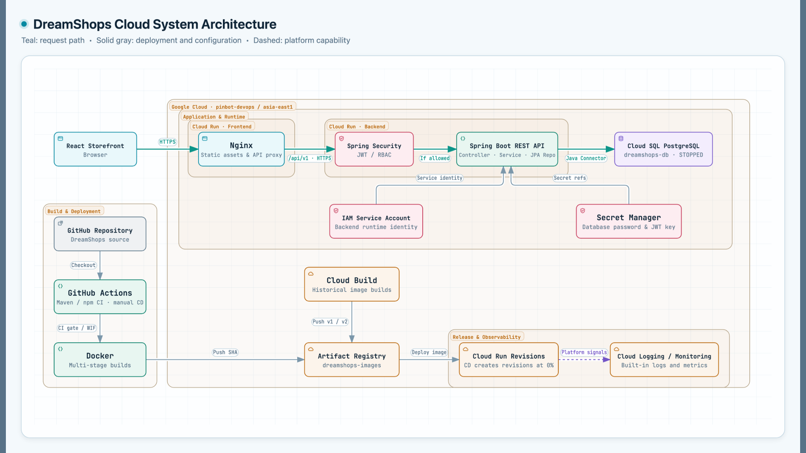

# DreamShops

DreamShops is a full-stack e-commerce application with a React storefront, a Spring Boot REST API, and PostgreSQL. The storefront and API were deployed as separate Cloud Run services in Google Cloud project `pinbot-devops`, region `asia-east1`.

**Deployment status (November 23, 2026).** Cloud Run services, revisions, and image records were verified through read-only checks. Cloud SQL reported `STOPPED` with activation policy `NEVER`, the cost-control setting used to stop the instance. Database-backed storefront features are unavailable while it remains stopped.

## Project Overview

- Customers can register, sign in, browse products and categories, search and sort the loaded catalog, and manage a shopping cart.
- Checkout creates a pending order, decrements stock, and clears the cart in one database transaction. Customers can view their own order history and order details.
- Administrators manage product, category, and image data through protected APIs. The [REST API contract](frontend/API.md) documents routes, payloads, and access rules.

PostgreSQL stores users, roles, products, images, carts, and orders. Order items record quantity and unit price at checkout. A cart lock and conditional stock updates protect concurrent checkout and roll back partial writes on inventory conflicts.

## Tech Stack

| Layer | Technologies |
| --- | --- |
| Frontend | React, TypeScript, Vite, React Router, Tailwind CSS, Nginx |
| Backend | Java 21, Spring Boot, Spring Security, JWT, Spring Data JPA, Hibernate, Maven |
| Database | PostgreSQL, Cloud SQL Java Connector for the cloud deployment |
| Build and delivery | Docker multi-stage builds, GitHub Actions, Workload Identity Federation, Cloud Build for historical image builds, Artifact Registry |
| Runtime and secrets | Cloud Run, Cloud SQL, Secret Manager, IAM |
| Tests | JUnit, Spring Boot Test, MockMvc, Vitest, React Testing Library |

## System Architecture



[Editable Archify source](docs/architecture/dreamshops-cloud-system-architecture.archify.json)

1. **Browser to frontend.** Nginx serves the React build on Cloud Run. The browser sends same-origin REST requests to `/api/v1`, which [Nginx](frontend/nginx.conf.template) proxies to the backend over HTTPS using `API_UPSTREAM`.
2. **Frontend to API.** Spring Security validates JWTs and applies route, role, and ownership checks. Controllers delegate business logic and transactions to services, and Spring Data JPA repositories handle persistence.
3. **API to database.** The Cloud SQL Java Connector provides the PostgreSQL connection. Cloud Run supplies the database password and JWT signing key from Secret Manager using the backend service identity.

## Cloud Infrastructure

| Resource | Role and verified configuration |
| --- | --- |
| Cloud Run | `dreamshops-frontend` runs Nginx. `dreamshops-backend` runs the Spring Boot API. Each service has its own revisions and traffic configuration. |
| Cloud SQL | `dreamshops-db` is a PostgreSQL 18 instance in `asia-east1`. The backend is configured for database `dreamshops`. |
| Artifact Registry | `dreamshops-images` is a regional Docker repository that stores historical version tags and images tagged with Git commit SHAs. |
| Cloud Build | Regional build records show successful historical builds for `dreamshops-frontend:v1` and `dreamshops-backend:v1` and `:v2`. The current GitHub Actions workflow builds with Docker on the runner. |
| Secret Manager and IAM | Cloud Run references the database password and JWT signing key as backend environment variables. The backend has a dedicated runtime service account. GitHub Actions uses a separate deployment identity through Workload Identity Federation. |
| Cloud Logging and Cloud Monitoring | Cloud Run provides request and container logs and service metrics. Project-specific dashboards and alerts have not been verified. See [Cloud Run logging](https://docs.cloud.google.com/run/docs/logging) and [monitoring](https://docs.cloud.google.com/run/docs/monitoring). |

Local development uses Vite's development proxy, a locally running Spring Boot process, and local PostgreSQL at `dream_shops_db`. You can run and test the project locally without GCP credentials.

## Deployment

### Containerization

- The [frontend Dockerfile](frontend/Dockerfile) installs dependencies with `npm ci`, builds the storefront with `npm run build`, and copies the static output into Nginx. The container listens on port `8080` and reads `API_UPSTREAM` at startup.
- The [backend Dockerfile](dream-shops/Dockerfile) packages the application with `mvn clean package -DskipTests` in a Maven build stage. The runtime image contains the JAR and a Java 21 JRE. Backend tests run separately in CI.

The historical release used version-tagged images from Cloud Build and deployed the two containers to Cloud Run. The build records confirm the published images. The current build, push, and deploy procedure is defined in the versioned workflows below.

### CI/CD and Release Management

| Stage | Trigger and behavior |
| --- | --- |
| [Continuous integration](.github/workflows/ci.yml) | Runs for pushes to `main` and pull requests targeting `main`. It runs Maven tests with disposable PostgreSQL, runs frontend type checking, linting, tests, and build, then validates both `linux/amd64` Docker builds. See the [successful CI run for `a799fe9`](https://github.com/Shaoen-Lin/Dreamshop/actions/runs/45135647668). |
| [Deployment workflow](.github/workflows/cd.yml) | Started manually through `workflow_dispatch`. It requires a successful push CI run for the selected commit on `main`, authenticates to GCP via GitHub OIDC and Workload Identity Federation, then uses `docker build` and `docker push` for each SHA-tagged image. It runs `gcloud run deploy --no-traffic` for both services. See the [successful deployment run for `a799fe9`](https://github.com/Shaoen-Lin/Dreamshop/actions/runs/45136201040). |
| Traffic promotion | Separate from revision creation. The verified deployment left new revisions at zero traffic and retained 100% on the previous revision of each service. Promotion, canary traffic splitting, and rollback drills remain future work. |

Cloud Run creates a revision when the service template changes. With `--no-traffic`, a new revision can be inspected before routing production requests to it. An operator can migrate traffic in stages or roll back by routing traffic to a previous revision. Database recovery is a separate operation. See [Cloud Run traffic migration and rollbacks](https://docs.cloud.google.com/run/docs/rollouts-rollbacks-traffic-migration).

## Security

- Spring Security uses a stateless filter chain. Login issues a signed JWT, and authenticated requests use the `Authorization: Bearer` header. The backend reloads account details and checks ownership for customer resources and roles for administrative writes.
- The cloud backend's [service identity](https://docs.cloud.google.com/run/docs/configuring/services/service-identity) authorizes access to Cloud SQL and [Secret Manager references](https://docs.cloud.google.com/run/docs/configuring/services/secrets). The deployment workflow authenticates independently through Workload Identity Federation.
- Keep database credentials and signing keys in the backend environment or Secret Manager. `VITE_API_BASE_URL` is public build-time configuration that is embedded in the frontend bundle.

## Testing and Validation

| Scope | Commands and coverage |
| --- | --- |
| Backend | From `dream-shops/`, run `./mvnw -B -ntp test` with a disposable local PostgreSQL database and the backend environment below. Tests cover JWT and authorization, concurrent cart creation, duplicate checkout, inventory contention, and transaction rollback. The tests modify data. |
| Frontend | From `frontend/`, run `npm ci`, `npm run typecheck`, `npm run lint`, `npm test`, and `npm run build`. Vitest exercises sign-in, protected routes, session expiry, catalog filtering, cart updates, and checkout with mocked API responses. |
| Container builds | CI validates both Docker build contexts after the application checks pass. |
| Historical deployment E2E | The recorded post-deployment smoke test exercised registration, login, product browsing, cart updates, checkout, and order lookup. This is historical validation. The automated workflows perform application tests, image builds, and revision creation. |

## Local Development

**Prerequisites** Java 21, Node.js 22.13+ on the 22.x line, npm, and OpenSSL. Use Docker for the disposable PostgreSQL example or point the backend at an existing local PostgreSQL instance. The backend includes the Maven Wrapper.

### 1. Start local PostgreSQL

From the repository root, start a disposable PostgreSQL 18 container. The password is generated for this local session.

```bash
export SPRING_DATASOURCE_URL=jdbc:postgresql://127.0.0.1:5432/dream_shops_db
export SPRING_DATASOURCE_USERNAME=postgres
export SPRING_DATASOURCE_PASSWORD="$(openssl rand -hex 24)"

POSTGRES_PASSWORD="$SPRING_DATASOURCE_PASSWORD" docker run -d --rm \
  --name dreamshops-db \
  -e POSTGRES_DB=dream_shops_db -e POSTGRES_USER=postgres -e POSTGRES_PASSWORD \
  -p 127.0.0.1:5432:5432 postgres:18

docker exec dreamshops-db pg_isready -h 127.0.0.1 -U postgres -d dream_shops_db
```

Wait until PostgreSQL accepts connections. Stopping this disposable container removes its data. With an existing PostgreSQL server, create `dream_shops_db` and export the matching datasource settings.

### 2. Start Spring Boot

In the same terminal, with the datasource variables set, start the backend. Hibernate creates or updates the local schema.

```bash
export AUTH_TOKEN_JWTSECRET="$(openssl rand -base64 32)"
cd dream-shops
./mvnw spring-boot:run
```

The REST API listens at `http://localhost:8080/api/v1`. [Swagger UI](http://localhost:8080/swagger-ui/index.html) is available while the local backend is running.

### 3. Start the storefront

Open a second terminal at the repository root.

```bash
cd frontend
npm ci
npm run dev
```

Open [the local storefront](http://localhost:5173). The [Vite configuration](frontend/vite.config.ts) proxies the default relative API path to port `8080`. A new database has an empty catalog. The [frontend setup guide](frontend/README.md#建立一筆本機測試商品) describes bootstrapping an admin and adding a sample product.

| Setting | Local use |
| --- | --- |
| `SPRING_DATASOURCE_URL`, `SPRING_DATASOURCE_USERNAME`, `SPRING_DATASOURCE_PASSWORD` | JDBC URL and credentials for local PostgreSQL. |
| `AUTH_TOKEN_JWTSECRET` | Base64-encoded signing key generated from at least 32 random bytes. |
| `SHOP_BOOTSTRAP_ADMIN_EMAIL`, `SHOP_BOOTSTRAP_ADMIN_PASSWORD` | Optional local admin bootstrap pair. |
| `VITE_API_BASE_URL`, `API_PROXY_TARGET` | Defaults to `/api/v1` and `http://127.0.0.1:8080`. See the [frontend environment example](frontend/.env.example). |
| `API_UPSTREAM` | Backend origin for the Nginx container. The Dockerfile defaults to `http://backend:8080` on a shared container network. |

## Project Structure

```text
.github/workflows/     CI checks and manually dispatched cloud deployment
docs/architecture/    Cloud architecture PNG and editable Archify source
dream-shops/          Spring Boot API, Maven Wrapper, and backend Dockerfile
  src/main/           Java application and Spring configuration
  src/test/           Integration and context tests
frontend/             React storefront, frontend Dockerfile, and Nginx template
  src/                Routes, components, API client, and tests
```

## Future Improvements

- Add an approval gate and smoke tests for promoting a staged Cloud Run revision.
- Rehearse gradual traffic migration and rollback, including checking database compatibility across revisions.
- Define a Cloud Monitoring dashboard and actionable alerts for request errors, latency, and failed database connections.

## Acknowledgments

The backend started from [dailycodework/dream-shops](https://github.com/dailycodework/dream-shops). DreamShops adds a React storefront, transactional cart and checkout behavior, automated tests, and a two-service Google Cloud deployment.
