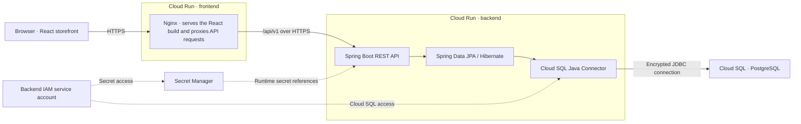

# Dreamshop

**Full-Stack E-Commerce Application**

## Project Overview

Dreamshop is a full-stack e-commerce application built with React, Spring Boot, and PostgreSQL. It pairs a customer storefront with a transactional backend and deploys the two applications as separate containers on Google Cloud Run.

## Features

- Account registration and login with JWT authentication.
- Product browsing, detail pages, category filters, keyword search, and price sorting. Search and sorting run on the catalog data loaded by the storefront.
- Shopping carts with quantity updates, item removal, and totals calculated by the backend.
- Checkout that creates a pending order, decrements stock, and clears the cart in one transaction. Customers can view their order history and order details.
- Inventory checks during checkout to prevent overselling. Catalog, category, and image writes are available through administrator APIs, and customer data is scoped to its owner.

## Tech Stack

| Layer | Technologies |
| --- | --- |
| Frontend | React, TypeScript, Vite, React Router, Tailwind CSS, Nginx |
| Backend | Java 21, Spring Boot 3.5.16, Spring Security, Spring Data JPA, Hibernate, Maven |
| Database | PostgreSQL |
| Containers and cloud | Docker, Cloud Run, Cloud SQL, Artifact Registry, Secret Manager, IAM |
| Testing | JUnit 5, Spring Boot Test, MockMvc, Vitest, React Testing Library |

## Architecture



The browser uses a same-origin API for both local development and the deployed storefront. Vite forwards API requests during development. Nginx handles the same routing in the frontend container.

## Project Structure

| Path | Contents |
| --- | --- |
| [`dream-shops/src/main/java/com/Shawn/dream_shops/`](dream-shops/src/main/java/com/Shawn/dream_shops/) | REST controllers, services, security, JPA entities, and repositories |
| [`dream-shops/src/main/resources/`](dream-shops/src/main/resources/) | Spring Boot configuration |
| [`dream-shops/src/test/java/com/Shawn/dream_shops/`](dream-shops/src/test/java/com/Shawn/dream_shops/) | Spring context and backend integration tests |
| [`frontend/src/`](frontend/src/) | Storefront routes, components, API client, and `app.test.tsx` |
| [Backend Dockerfile](dream-shops/Dockerfile), [Frontend Dockerfile](frontend/Dockerfile), [Nginx template](frontend/nginx.conf.template) | Container builds and runtime proxy configuration |

## Getting Started

Use Java 21, Node.js 22.13+ (22.x), npm, and OpenSSL. The backend includes the Maven Wrapper. The PostgreSQL example uses Docker, or you can connect to an existing local PostgreSQL server.

### Environment Variables

| Variable | Purpose |
| --- | --- |
| `SPRING_DATASOURCE_URL` | Backend JDBC URL. The local default is `jdbc:postgresql://localhost:5432/dream_shops_db`. |
| `SPRING_DATASOURCE_USERNAME` | PostgreSQL user. The local default is `postgres`. |
| `SPRING_DATASOURCE_PASSWORD` | Password for the selected PostgreSQL user. |
| `AUTH_TOKEN_JWTSECRET` | Backend signing key. Supply Base64-encoded random data of at least 32 bytes. |
| `SHOP_BOOTSTRAP_ADMIN_EMAIL`, `SHOP_BOOTSTRAP_ADMIN_PASSWORD` | Optional pair for creating a local administrator at startup. |
| `VITE_API_BASE_URL` | Public frontend API path. Defaults to `/api/v1`. |
| `API_PROXY_TARGET` | Vite's development and preview proxy target. Defaults to `http://127.0.0.1:8080`. |
| `API_UPSTREAM` | Backend origin for the Nginx container. Defaults to `http://backend:8080` on a shared Docker network. |

### PostgreSQL

In a terminal at the repository root, start a disposable local database. For an existing local PostgreSQL server, create `dream_shops_db` and export the matching datasource settings instead.

```bash
export SPRING_DATASOURCE_URL=jdbc:postgresql://127.0.0.1:5432/dream_shops_db
export SPRING_DATASOURCE_USERNAME=postgres
export SPRING_DATASOURCE_PASSWORD="$(openssl rand -hex 24)"

POSTGRES_PASSWORD="$SPRING_DATASOURCE_PASSWORD" docker run -d --rm \
  --name dreamshops-db \
  -e POSTGRES_DB=dream_shops_db -e POSTGRES_USER=postgres -e POSTGRES_PASSWORD \
  -p 127.0.0.1:5432:5432 postgres:16

docker exec dreamshops-db pg_isready -h 127.0.0.1 -U postgres -d dream_shops_db
```

Repeat the last command until PostgreSQL accepts connections. Stopping this disposable container removes its local data.

### Backend

In the same terminal, with the datasource variables still set, run the backend. Hibernate creates or updates the schema on startup.

```bash
export AUTH_TOKEN_JWTSECRET="$(openssl rand -base64 32)"
cd dream-shops
./mvnw spring-boot:run
```

The API is available at `http://localhost:8080/api/v1`. Open [Swagger UI](http://localhost:8080/swagger-ui/index.html) to explore individual endpoints.

### Frontend

In a second terminal at the repository root, start the storefront.

```bash
cd frontend
npm ci
npm run dev
```

Open [http://localhost:5173](http://localhost:5173). A new database starts with an empty catalog. The [frontend guide](frontend/README.md) explains how to bootstrap a local administrator and add a sample product.

## Database Design

- A `User` can have multiple `Role` records through `user_roles`, one `Cart`, and multiple `Order` records.
- Each `Product` belongs to a `Category` when assigned and can have multiple `Image` records. The product also stores its current price and inventory.
- `CartItem` links a cart to a product. `OrderItem` links an order to a product and records its quantity and unit price at checkout.

Spring Data JPA repositories perform queries and updates. Hibernate maps the entities and relationships to PostgreSQL. Checkout uses a Spring-managed transaction, database locking, and a conditional inventory update to coordinate concurrent requests.

## API Overview

All routes below use the `/api/v1` prefix. See the [full REST API contract](frontend/API.md) for payloads, access rules, and errors.

| Area | Method and path | Purpose |
| --- | --- | --- |
| Authentication | `POST /users/add` · `POST /auth/login` | Register a customer and obtain a JWT at login |
| Products | `GET /products/all` · `GET /products/product/{id}/product` | List products and read product details |
| Categories | `GET /categories/all` · `GET /products/product/{category}/all/products` | List categories and browse products in one category |
| Shopping cart | `GET /carts/{cartId}/my-cart` · `POST /cartItems/item/add` | Read the customer's cart and add a product |
| Checkout | `POST /orders/order?userId={userId}` | Place an order for the authenticated customer |
| Orders | `GET /orders/{userId}/orders` · `GET /orders/{orderId}/order` | Read order history and order details |

## Testing

- **Backend — 7 JUnit cases.** One context-load test and six integration tests cover authorization, JWT invalidation after account deletion, concurrent cart and checkout requests, and inventory rollback. Set up a fresh disposable PostgreSQL database and the backend environment variables above. Run `./mvnw test` from `dream-shops/`. The tests write and delete test data.
- **Frontend — 8 Vitest cases.** Tests use jsdom and mocked API responses to cover login, session expiry, catalog filtering, checkout, and error messages. Run `npm ci` and `npm test` from `frontend/`. The same directory supports `npm run typecheck`, `npm run lint`, and `npm run build`.

## Deployment

The two Docker images were published to the `dreamshops-images` Artifact Registry repository and deployed as `dreamshops-frontend` and `dreamshops-backend` in Cloud Run's `asia-east1` region. The backend uses the Cloud SQL Java Connector for PostgreSQL and a dedicated IAM service account for Cloud SQL and Secret Manager access. Cloud Run supplies the database password and JWT signing key to the backend through Secret Manager references.

Registration, login, product browsing, cart updates, checkout, and order history were tested after deployment. **Cloud SQL is currently stopped. The live storefront's database-backed features are unavailable while it is stopped.**

## Acknowledgments

The backend started from [dailycodework/dream-shops](https://github.com/dailycodework/dream-shops). This repository extends that foundation with a React storefront, transactional cart and checkout handling, automated tests, and a two-service Google Cloud deployment.
